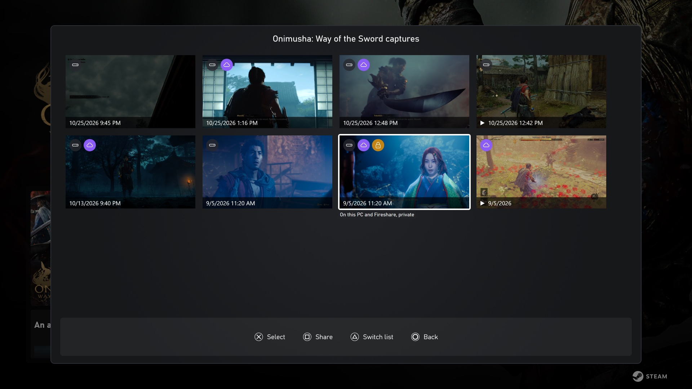

<p align="center">
  
</p>

<h1 align="center">Fireshare Share</h1>

<p align="center">
  Share Playnite screenshots and clips to your own <a href="https://github.com/fireshare-app/fireshare">Fireshare</a>, from the couch.
  <br><br>
  <a href="https://github.com/hung-eggie-do-covergo/playnite-fireshare/releases/latest"></a>
  <a href="https://github.com/hung-eggie-do-covergo/playnite-fireshare/actions"></a>
  <a href="LICENSE"></a>
</p>

<p align="center">
  
</p>

## Features

- Pick captures in a grid, with a controller in fullscreen mode or a mouse in desktop mode.
- See what is where: a drive icon for this PC, a cloud for Fireshare, a lock for private.
- Captures that are only on Fireshare show too. Sharing one copies its link without uploading.
- Press **X** on a ScreenshotsVisualizer screenshot to share it, in any theme.
- Uses ScreenshotsVisualizer's game index when installed, so its folder settings and overrides apply.
- Never uploads a file twice. Links go to the clipboard.

## Install

Download the `.pext` from [Releases](https://github.com/hung-eggie-do-covergo/playnite-fireshare/releases/latest) and open it with Playnite.

Requires Fireshare 1.9 or newer.

## Setup

1. In Fireshare, open **Settings → Security → Upload Tokens** and create a token.
2. In Playnite desktop mode, open **Add-ons → Extension settings → Fireshare Share**. Enter the Fireshare URL and the token, then click **Test connection**.
3. Optional: under **Private items**, sign in as a Fireshare user to see private captures. Only the session is kept, encrypted; the password is not stored.
4. Fireshare makes new uploads private by default. Set the default privacy for images and videos to public if links should open for anyone.

## Use

Game menu → **Share captures to Fireshare…** (under **Extensions** in fullscreen mode).

| Button | Action |
| --- | --- |
| D-pad | Move |
| A | Select |
| X | Share the selection, or the focused capture |
| Y | Switch between this game and all captures |
| B | Back |

Fireshare-only captures appear for games Fireshare already has. Uploads are linked to the Fireshare game of the same name.

Supported files: `png`, `jpg`, `jpeg`, `webp`, `gif`, `mp4`, `m4v`, `mov`, `webm`. Fireshare does not take HDR `.jxr` screenshots; share the `.png` Game Bar saves next to them.

The token and session are stored with Windows DPAPI for your user account.

## Theme integration

Themes can add a share prompt wherever they show a screenshot. The command takes a file path, or an item with a `FileName` property such as a ScreenshotsVisualizer screenshot:

```xml
<!-- {PluginSettings} works only on a normal element inside a template -->
<ContentControl x:Name="Fireshare_Command" Content="{PluginSettings Plugin=FireshareShare, Path=ShareCommand}"
                Visibility="Collapsed" Focusable="False" />

<ListView.InputBindings>
    <pin:GameControllerInputBinding Button="X" Command="{Binding Content, ElementName=Fireshare_Command}"
                                    CommandParameter="{Binding SelectedItem, ElementName=ListSV}" />
</ListView.InputBindings>
```

## Build

```sh
./pack.sh                    # dist/FireshareShare-<version>.pext
dotnet run --project tests
```

Builds on macOS, Linux or Windows with the .NET SDK. Not affiliated with the Fireshare project.
